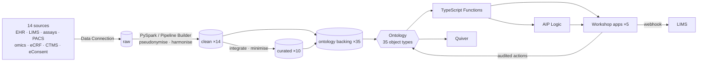

# TrialLens

**Governed clinical & omics data products and workflow apps for neurodegeneration research, built on Palantir Foundry.**

[](https://github.com/maxxrichard/TrialLens/actions/workflows/ci.yml)

TrialLens gives clinical and translational teams one governed view of fragmented study
data (EHR extracts, lab and fluid-biomarker series, imaging metadata, omics) as Foundry
data products and Workshop apps. Teams use them for cohort selection, biomarker review and
operational decisions, and auditability is built in.

`Palantir Foundry` · `Pipeline Builder` · `PySpark` · `Ontology` · `Workshop` · `Quiver` · `AIP Logic` · `TypeScript` · `SQL` · `Markings / ACL`

> All data in this repository is synthetic. No real patient data, credentials or
> environment-specific identifiers are committed.

## At a glance

| | |
|---|---|
| Sources | **14** (EHR ×4, LIMS ×2, biomarker assays, imaging ×2, omics ×2, eCRF, CTMS, eConsent) |
| Pipelines | PySpark transforms + Pipeline Builder boards: raw → clean (14) → curated (10) → ontology backing (35) |
| Data quality | **120** data expectations (24 datasets × 5) + 7 record-level rules feeding a triage queue |
| Ontology | **35** object types in 8 domains, 42 link types, 7 audited action types |
| Access control | 6 markings, pseudonymisation boundary, consent-aware eligibility, action submission criteria |
| Apps | **5** Workshop apps, 2 Quiver analyses, 3 AIP Logic flows, 6 SQL analyses |
| Functions | TypeScript: cohort criteria engine, biomarker review suggestions, DQ triage |
| Delivery | CI on every push, branch-per-feature mirrored in Foundry, tagged releases |

## Architecture



Details: [docs/architecture.md](docs/architecture.md).

## Workshop apps

| App | For | What it does |
|---|---|---|
| [Cohort Builder](workshop/cohort-builder.yaml) | scientists, clinicians | criteria → live attrition funnel → draft cohort → lock for reproducible analysis; plain-language criteria via AIP Logic |
| [Biomarker Review](workshop/biomarker-review.yaml) | biomarker lab | run-by-run review queue with suggested decisions (QC, LLOQ/ULOQ, reference range, change from previous) and audited decisions |
| [Data Quality](workshop/data-quality-dashboard.yaml) | data stewards, engineers | expectations per dataset, record-level issues triaged by severity, SLA and locked-cohort impact |
| [Specimen Tracker](workshop/specimen-tracker.yaml) | biobank, scientists | aliquot availability, pre-analytics, storage; retrieval requests to the LIMS |
| [Study Operations](workshop/study-operations.yaml) | study ops | recruitment per study and site, consent coverage and consent gaps |

## Repository layout

```
transforms-python/            Foundry Python transforms repository
  src/triallens/
    config/                   sources.yaml (14 sources), expectations.yaml (120 checks)
    logic/                    pure PySpark business logic per domain (unit tested)
    pipeline_spec.py          the DAG, shared by Foundry and the local runner
    foundry/                  generated Foundry transforms (+ checks, markings)
    ontology_backing.py       backing datasets generated from ontology/*.yaml
    quality/                  expectation engine, Foundry check generation, record rules
    local/                    local runner, CLI, synthetic data generator
  tests/                      unit + end-to-end tests
ontology/                     object types, link types, action types (YAML)
markings/                     markings, groups, propagation rules
functions-typescript/         Foundry Functions (logic + Foundry bindings, Jest tests)
workshop/                     Workshop app specs
quiver/                       Quiver analysis specs
aip-logic/                    AIP Logic flows and evaluation cases
pipeline-builder/             exported Pipeline Builder pipelines
sql/                          analytical SQL on curated datasets (run in CI)
tools/validate_specs.py       cross-checks apps / flows / boards against the ontology
docs/                         architecture, discovery, release management, runbook
```

## Run it locally

Requires Python ≥ 3.10, Java 17 (for Spark) and Node 20.

```bash
make install           # pip install -e ".[dev]"
make run               # generate synthetic extracts, run the full pipeline, print the expectation report
make test test-e2e     # unit tests, then the end-to-end pipeline test
make validate          # app / flow / board specs vs. ontology
make functions-install functions-test
```

`make run` writes every clean, curated and ontology backing dataset as parquet under
`data/out/` and exits non-zero if any of the 120 expectations fails.

## What CI checks

* `ruff` lint, spec validation (Workshop, Quiver, AIP Logic, Pipeline Builder ↔ ontology).
* Unit tests for parsing, pseudonymisation (Spark ↔ Python parity), clinical coding,
  unit harmonisation, APOE haplotypes and the expectation engine.
* End-to-end: synthetic extracts for all 14 sources → full DAG → all 120 expectations
  pass → every ontology backing dataset matches its object type (columns, types, unique
  primary keys, non-empty) → every link resolves → no MRN outside the restricted layer →
  all SQL analyses run.
* TypeScript type-check and Jest tests for the Functions logic.

## Governance in brief

* **Pseudonymisation**: MRNs are replaced by keyed SHA-256 pseudonyms in the clean layer;
  the salt is in a DPO-only dataset. Curated data is minimised (birth year, 2-digit
  postal region, no ethnicity).
* **Markings** follow lineage; the direct-identifier marking is only dropped by the
  reviewed curated transforms. Genetic data carries its own marking.
* **Consent-aware**: current consent per scope is part of each patient's features;
  ineligible patients never enter cohorts, and APOE criteria need genetics consent.
* **Audit**: every cohort, review decision and issue update is an action in the action
  log; locked cohorts freeze criteria and membership.

See [markings/README.md](markings/README.md) and [docs/release-management.md](docs/release-management.md).

## License

[MIT](LICENSE)
