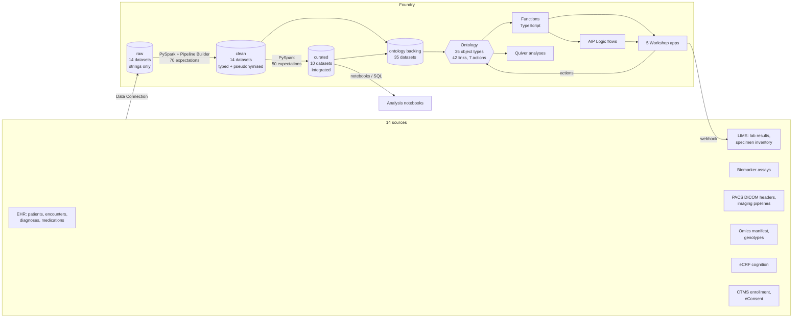

# Architecture

## Layers

| Layer | Datasets | What happens | Markings |
|---|---|---|---|
| raw | 14 | Data Connection syncs, unmodified, all strings | `DIRECT_IDENTIFIERS` |
| clean | 14 | parse dates / decimals, harmonise codes and units, de-duplicate, pseudonymise MRNs | `DIRECT_IDENTIFIERS` |
| curated | 10 | integrate across sources, data minimisation, derived features | `PSEUDONYMIZED_CLINICAL` |
| ontology | 35 | one backing dataset per object type, generated from YAML | per object type |

## One spec, two runtimes

`triallens/pipeline_spec.py` declares the DAG once. It is turned into:

* **Foundry transforms** (`triallens/foundry/step_transforms.py`): one `@transform_df`
  per step, outputs carrying the `Check`s generated from `config/expectations.yaml`, the
  pseudonymisation salt read from a restricted dataset, and `stop_propagating` of the
  direct-identifier marking where the curated layer drops identifying fields.
* **Local runner** (`triallens/local/runner.py`): the same functions on a local
  SparkSession over synthetic CSVs, used by `make run` and by CI.

Ontology backing datasets are generated the same way from `ontology/object_types/*.yaml`
(`triallens/ontology_backing.py`), so a new object type is a YAML change plus, at most,
a new column in a curated dataset.

## Curated datasets

| Dataset | Grain | Built from |
|---|---|---|
| `patient_master` | patient | EHR patients + encounters (birth year, age band, 2-digit region) |
| `encounter_timeline` | encounter | EHR encounters (+ length of stay) |
| `diagnosis_curated` | diagnosis | EHR diagnoses (+ ICD chapter, disease group) |
| `specimen_inventory` | specimen | LIMS (+ processing delay) |
| `biomarker_timeseries` | measurement | assays (via LIMS specimens) + routine labs, unit-harmonised, reference-range flags |
| `imaging_studies` | series | DICOM series + latest derived measures (hippocampal volume, SUVR, thickness) |
| `omics_samples` | omics sample | manifest + LIMS specimens |
| `cognitive_scores` | assessment | eCRF (+ normalised score, impairment flag) |
| `study_participation` | enrollment | CTMS + current consent state per scope |
| `cohort_features` | patient | everything above: latest cognition and biomarkers, amyloid status, APOE, data availability, consent, eligibility |

## Write paths

Users never edit datasets. All writes go through **actions** (`ontology/action_types.yaml`):
cohort creation and membership, biomarker review decisions and data-quality triage
are ontology edits recorded in the action log; specimen retrieval requests are sent to
the LIMS by webhook, which remains the system of record for specimen status.

## Integrations

* **LIMS**: hourly result and inventory syncs in; retrieval requests out (webhook action).
* **Analysis notebooks**: curated datasets are exposed read-only to Code Workspaces
  (Jupyter / RStudio) with the same markings; locked cohorts give notebooks a stable,
  versioned patient list.
* **Pseudonym parity**: `pseudonymize_value` (pure Python) produces the same pseudonym as
  the Spark implementation, so the LIMS and notebooks can join on `TL-P-*` ids without
  ever seeing MRNs in the platform.
